# QUIZVERSE LIVE — PHASE 13
# PRODUCT QUALITY, UX/UI AND EXPERIENCE AUDIT

**Audit Date**: November 17, 2026  
**Document**: `PHASE_13_PRODUCT_UX_UI_AUDIT.md`  
**Target Repository**: `T:\Projects\quizverse-live\quizverse-live-python`  
**Evaluation Nature**: Read-only product quality, user experience, visual hierarchy, responsive layout, and accessibility audit.

---

## 1. Executive Summary

QuizVerse Live is designed to be a high-caliber consumer multiplayer quiz gaming platform and AI-powered learning ecosystem. Following the completion of the 12 engineering roadmap stages, the platform possesses an authoritative single-process architecture, a zero-failure regression test suite (460/460 passed), 9 distinct game formats, competitive Elo and tournament infrastructures, real-time presence and messaging, adaptive learning intelligence, and a community quiz marketplace.

However, an empirical UX/UI and device inspection reveals significant user-experience friction, responsive layout defects, and accessibility limitations:
1. **Critical CSS Syntax Bug**: A malformed CSS selector (`.@media(max-width:600px)` on line 25 of `styles.css`) causes modern browsers to drop the entire mobile stylesheet block for the Escape Room game mode.
2. **AI Intelligence Hub Layout Blowout**: Unconstrained flex children inside `.app-shell` cause horizontal overflows exceeding **+393px** on mobile viewports and **+196px** on tablet screens.
3. **Mobile Navigation Truncation**: A top navigation bar housing 9 primary tabs hides 4 to 5 tabs on mobile screens behind an unstyled, invisible scrollbar (`scrollbar-width: none`), hiding core features (Leagues, Tournaments, Rankings, Library, Profile) from discoverability.
4. **Sub-Standard Touch Target Sizes**: Primary navigation tabs and interactive pills measure 30px to 36px in height on touch viewports, failing the 44×44px WCAG 2.1 AA recommendation.
5. **Mobile Information Hierarchy Friction**: On mobile screens, the primary game entry point (`.play-card` create/join arena) is pushed completely below the fold beneath an oversized 68px hero headline and a 245px decorative graphic.
6. **Micro-Typography & Low Contrast**: Over 75 UI elements employ font sizes between 8px and 11px with muted contrast ratios (3.5:1 to 4.2:1) that impair legibility on mobile displays.

This audit establishes an evidence-based quality baseline, identifies confirmed defects, and outlines a prioritized implementation roadmap for Phase 13 Task 2.

---

## 2. Verified Repository and Git State

The repository state was inspected prior to audit execution:

```
Repository Path:  T:\Projects\quizverse-live\quizverse-live-python
Branch:           main
Latest Commit:    568a952a07d2e1280888a3d5d0c3bf0a6e6898b7 (short: 568a952)
Commit Message:   Complete production excellence and deployment readiness
Parent Commit:    3b146d2 Implement complete creator and community ecosystem
Working Tree:     Clean (nothing to commit, working tree clean)
Node.js Project:  T:\Projects\quizverse-live\quizverse-live (Untouched; Last Modified: 2026-10-26 16:56:44)
Python Runtime:   Python 3.13.17 with psycopg[binary] 3.3.9
Dependencies:     pip check -> No broken requirements found
JS Syntax:        node --check quizverse/static/app.js -> Clean (exit code 0)
```

No application source files, database migrations, models, or configuration templates were altered during this audit.

---

## 3. Product Feature Inventory

The QuizVerse Live application currently incorporates six major functional domains:

```mermaid
flowchart TD
    Shell["QuizVerse Live Application Shell"]
    Shell --> Core["Core Gaming Arena (9 Modes)"]
    Shell --> Comp["Competitive Ecosystem"]
    Shell --> Social["Social & Messaging Hub"]
    Shell --> AI["AI Intelligence Hub"]
    Shell --> Comm["Creator & Community"]
    Shell --> Profile["Player Identity & Career"]

    Core --> M1["Classic / Speed / Team Battle"]
    Core --> M2["Elimination / Solo / Royale"]
    Core --> M3["Power Play / Bluff Master / Escape Room"]

    Comp --> C1["Global & Mode Elo Ratings"]
    Comp --> C2["Tournaments & Brackets"]
    Comp --> C3["Leagues & Seasonal Standings"]

    Social --> S1["Friends & Presence"]
    Social --> S2["Direct Messages & Room Chat"]
    Social --> S3["Invitations & Rematches"]
    Social --> S4["Notification Center"]

    AI --> A1["Weakness Diagnosis & Mastery"]
    AI --> A2["Adaptive Difficulty & Curriculums"]
    AI --> A3["AI Quiz Generator"]

    Comm --> CM1["Public Catalog & Discovery"]
    Comm --> CM2["Quiz Studio & Validation"]
    Comm --> CM3["Reviews, Collections & Moderation"]
```



| Area | Features Present | Storage & Engine Mechanism |
| :--- | :--- | :--- |
| **A. Core Arena** | 9 game formats, six-character room codes, lobby management, real-time presence indicators, reconnect tokens. | Server-authoritative `GameEngine` + `ConnectionHub` in process memory. |
| **B. Competitive** | Elo ratings, provisional status (under 5 matches), peak ratings, win/loss streaks, single-elimination tournament brackets, seasonal leagues. | SQLAlchemy models: `PlayerRating`, `RatingHistory`, `Tournament`, `League`. |
| **C. Social** | Friend requests, presence dots (online, in_lobby, in_match, offline), direct messaging with read receipts and emoji reactions, room chat drawer, in-app notification center. | `FriendService`, `DirectMessageService`, `NotificationService`, `PresenceService`. |
| **D. AI & Learning** | Topic mastery progress bars, weakness identification, adaptive difficulty recommendations, structured learning paths, AI learning reports, quality score gauge. | `AdaptiveDifficultyEngine`, `WeaknessEngine`, `RecommendationEngine`. |
| **E. Creator Hub** | Public quiz discovery, search and multi-format filtering, creator profiles, 4-step quiz creator studio with quality validation, reviews, collections, moderation queue. | `CommunityQuizService`, `CreatorProfileService`, `ModerationService`. |
| **F. Profile** | Pseudonymous bearer credential authentication, career overview cards, accuracy rates, forfeit monitoring, match history filtering. | `PlayerIdentityService`, `PlayerMatchHistory`. |

---

## 4. Nine-Mode Gameplay Evaluation

Every game format was evaluated across the complete lifecycle: Lobby, Question Presentation, Timer Dynamics, Scoring Feedback, and Results/Podium.

| Mode | Format & Timing | Strengths | UX / UI Friction Points |
| :--- | :--- | :--- | :--- |
| **1. Classic** | 10 rounds, 15s deadline, Momentum Shift active. | Clean 4-option answer grid, immediate feedback pop animation, intuitive podium. | Leaderboard side-stack collapses on mobile; players cannot see live rank without scrolling. |
| **2. Speed Challenge** | 10 rounds, 10s deadline, Momentum Shift off. | Fast-paced countdown ring; scaled speed points encourage fast reflexes. | 10s timer causes high anxiety on mobile when question text spans 3 lines. |
| **3. Team Battle** | 4–8 players, even rosters, Team Violet vs. Cyan. | Live aggregate team scoreboard, distinct team color accents (`--team-violet`, `--team-cyan`). | Team assignment occurs strictly by join order; no pre-game team swapping or captain selection. |
| **4. Elimination** | 10 rounds, 15s deadline, sudden death. | High tension; clean `eliminated-watching` spectator card with spectator mode. | Eliminated players cannot interact or cheer; spectator view is visually stark. |
| **5. Solo Practice** | 10 questions, untimed or relaxed, personal stats. | Instant replay button preserves player identity; detailed accuracy and review summary. | Lacks an explicit "Review Answers" drill-down to inspect correct explanations. |
| **6. Quiz Royale** | 4–20 players, 3 lives, 12s deadline. | Prominent `life-pill` indicator, reconnection preserves life count, last-survivor ranking. | On 20-player matches, lobby player list overflows awkwardly on mobile screens. |
| **7. Power Play** | 10 rounds, energy bar, 3 tactical abilities. | Interactive ability bar (50:50, Double Points, Shield), private action confirmations. | Ability buttons wrap into 1 column on mobile (`max-width: 540px`), consuming vertical screen space above options. |
| **8. Bluff Master** | 10 rounds, 3 phases (Bluff, Vote, Reveal). | Engaging social mechanics; fake answers mixed anonymously; own answer disabled during voting. | Phase instructions are small (`.95rem`); typing fake answer on mobile brings up keyboard that obscures timer. |
| **9. Escape Room** | 5 rooms, 10 puzzles, 15m shared timer, 3 hints. | Cooperative map nodes (current, solved), shared hints, team victory celebration. | **Severe**: CSS syntax error (`.@media`) prevents mobile responsive rules from executing. |

---

## 5. Viewport and Device Responsiveness Findings

Empirical testing was executed across five standardized viewports using Playwright Chromium:

```
Tested Viewports:
  • Desktop Large:  1440 × 900 px
  • Desktop Laptop: 1280 × 720 px
  • Tablet:         768 × 1024 px
  • Mobile Large:   390 × 844 px (iPhone 12/13/14)
  • Mobile Compact: 375 × 667 px (iPhone SE / Standard Mobile)
```

### A. Desktop (1440 × 900 & 1280 × 720)
- **1440 × 900**: Excellent balance. Hero illustration (`.core-orb`, `.orbit`) sits prominently beside `.play-card`. Topbar spans cleanly with 9 visible links.
- **1280 × 720**:
  - The AI Intelligence navigation bar (`.intel-nav`) has 8 non-wrapping tabs totaling ~1,250px width. Inside the padded container, it overflows by **+73px**, causing slight horizontal scroll on laptops.
  - Modals and cards render centered with appropriate padding.

### B. Tablet (768 × 1024)
- **Navigation Bar**: `.primary-navigation` enters `overflow-x: auto` with `scrollbar-width: none`. Nav links shrink to `min-height: 30px` and `padding: 0 5px`, with `font-size: 10.5px`.
- **AI Intelligence Hub**: `.intel-shell` expands to 964px inside the flex container, causing a **+196px horizontal document overflow**.
- **Tournament Brackets**: `.bracket-scroll-container` functions correctly with horizontal touch scrolling.

### C. Mobile (390 × 844 & 375 × 667)
- **Navigation Bar**:
  - Only **5 of the 9 primary tabs** are visible on screen (Play, AI Intelligence, Community, Social, Leagues).
  - Tournaments, Rankings, Quiz Library, and Player Profile are pushed off-screen to the right (up to +229px).
  - Because `scrollbar-width: none` is active, there is zero visual affordance (no fade gradient, scrollbar, or chevron) to inform the user that more tabs exist.
- **Home Screen Information Hierarchy**:
  - Hero title renders at 68px.
  - Decorative `.hero-art` orb measures 245px in height.
  - The actual interactive form (`.play-card` where the user inputs their nickname, selects a mode, and creates/joins a game) requires scrolling 450px down before becoming visible.
- **AI Intelligence Hub Blowout**:
  - On 390px screens: Document overflows by **+385px**.
  - On 375px screens: Document overflows by **+393px** (page is 768px wide, more than double screen width).
  - This occurs because `.intel-shell` lacks `width: 100%` and `min-width: 0` inside the `#app.app-shell` flex container.
- **Escape Room Mobile Degradation**:
  - Due to the malformed `.@media(max-width:600px)` selector in `styles.css`, `.escape-progress` fails to stack vertically, the puzzle map gap remains uncompressed, and the final results grid remains locked in 2 columns.

---

## 6. Accessibility & Usability Findings

### A. Touch Target Sizing (WCAG 2.1 Success Criterion 2.5.5 / 2.5.8)
Standard guidelines require interactive touch targets to be at least **44 × 44 pixels** (or 48 × 48 dp on Android):

| Interactive Element | Actual Mobile Dimensions | Status |
| :--- | :--- | :--- |
| Primary Navigation Links (`.nav-link`) | **34px × 30px** to **78px × 30px** | **FAIL** (< 44px height) |
| Notification Bell Button (`#notif-bell-btn`) | **36px × 32px** | **FAIL** (< 44px) |
| AI Intelligence Tab Buttons (`.intel-tab-btn`) | **Height: 33px** | **FAIL** (< 44px height) |
| Community Tab Buttons (`.comm-tab-btn`) | **Height: 36px** | **FAIL** (< 44px height) |
| Bracket Match Action Buttons (`.btn-quiet`) | **Height: 28px**, `font-size: .72rem` | **FAIL** (< 44px) |
| Mode Selector Dropdown (`#game-mode`) | Height: 48px | **PASS** |
| Answer Buttons (`.answer-button`) | Height: 61px | **PASS** |

### B. Micro-Typography & Readability
Over 75 distinct element types use font sizes below **11.5px**:
- `.connection-indicator` on mobile: **8px**
- `.format-pill`, `.comm-badge`, `.final-stat`: **9px – 10px**
- `.eyebrow`, `.section-kicker`, `.microcopy`: **10px**
- Primary navigation links on tablet: **10.5px**
- Form labels and field hints: **11px**

*Impact*: 8px to 10px text in a dark-mode theme is nearly illegible on standard handheld screens without zooming, violating basic readability conventions.

### C. Color Contrast (WCAG 2.1 AA)
- Normal text requires a minimum contrast ratio of **4.5:1**.
- Microcopy elements (`#8587a6`, `#707294`, `#6b6d8c`) rendered against dark background surfaces (`#090a18`, `#141527`) achieve contrast ratios between **3.5:1 and 4.1:1**, falling below the AA threshold.

---

## 7. Social, Competitive, AI, and Creator Experience Findings

### Social & Messaging Hub
- **Positive**: Direct messaging supports real-time socket delivery, typing indicators, soft delete, message editing, and emoji reactions.
- **Friction**: When an unauthenticated visitor clicks "Social", they are met with a dead-end message: *"Player Profile Required"*. There is no inline one-click creation flow; they must navigate away to the Profile view.
- **Room Chat**: The in-game chat drawer (`.room-chat-drawer`) occupies 340px and overlays the game screen cleanly, but on mobile portrait mode it obscures question choices when open.

### Competitive Ecosystem
- **Positive**: Elo calculation, established vs. provisional weighting, rating delta pills (`+16`, `-12`), and tournament bracket tree visualization are comprehensive.
- **Friction**: In tournament brackets, action buttons (`Play Match`, `Forfeit`, `Dispute`) inside match nodes are styled with `padding: .3rem .5rem` and `font-size: .72rem`. On mobile touch screens, tapping "Play Match" risks accidental forfeiture due to close button proximity.

### AI Intelligence Hub
- **Positive**: Complete feature coverage—topic mastery bars, adaptive difficulty rationale, structured step-by-step learning paths, AI-generated learning reports.
- **Friction**: Aside from the layout blowout bug, the AI Hub requires a profile credential. When missing, it renders a card directing users to "Go to Profile", rather than offering a lightweight inline pseudonym input.

### Creator & Community Ecosystem
- **Positive**: End-to-end quiz publishing lifecycle (Draft -> Published -> Moderation), search filtering, 4-step creation studio with instant quality score gauge.
- **Friction**: The creator quiz form on mobile has multi-column grids (`.creator-options-grid: 1fr 1fr`) that compress answer option inputs into narrow text boxes.

---

## 8. Confirmed Bugs and Defect Log

| Bug ID | Severity | Affected Area | Reproduction Steps | Expected Behavior | Actual Behavior | Evidence / Code Reference |
| :--- | :--- | :--- | :--- | :--- | :--- | :--- |
| **BUG-01** | **High** | Escape Room Mode | 1. Launch app.<br>2. Select Escape Room.<br>3. View on mobile viewport (<= 600px). | Escape Room map, node padding, actions, and results grid should adapt to mobile viewport. | CSS rules are completely ignored by the browser due to invalid selector syntax. | [styles.css:25](file:///T:/Projects/quizverse-live/quizverse-live-python/quizverse/static/styles.css#L25): `mode-picker .field:disabled{opacity:.7}.@media(max-width:600px){...}` (Stray dot before `@media`). |
| **BUG-02** | **High** | AI Intelligence Hub | 1. Navigate to "AI Intelligence".<br>2. Set viewport to Tablet (768px) or Mobile (375px/390px). | `.intel-shell` should fit 100% within viewport without horizontal body scroll. | `.intel-shell` expands to 964px on tablet (+196px overflow) and 768px on mobile (+393px overflow). | [styles.css:447](file:///T:/Projects/quizverse-live/quizverse-live-python/quizverse/static/styles.css#L447): `.intel-shell` lacks `width: 100%; max-width: 100%; min-width: 0;` inside `#app.app-shell` flex container. |
| **BUG-03** | **Medium** | Primary Navigation | 1. Open app on any device <= 768px wide.<br>2. Look at header navigation. | User should see clear navigation indicators or a responsive mobile menu/drawer. | Tabs 6 through 9 are pushed off-screen with `scrollbar-width: none`. Users are unaware that Tournaments, Rankings, Library, or Profile exist. | [styles.css:264](file:///T:/Projects/quizverse-live/quizverse-live-python/quizverse/static/styles.css#L264): `header .primary-navigation{scrollbar-width:none !important}` without scroll affordance or hamburger drawer. |
| **BUG-04** | **Medium** | Mobile Touch Targets | 1. Inspect navigation links, bell button, and sub-tabs on touch viewports. | Touch targets should meet 44×44px WCAG 2.1 AA minimums. | Navigation links measure 30px high; sub-tabs measure 33px–36px high. Frequent mis-taps on mobile fingers. | [styles.css:265](file:///T:/Projects/quizverse-live/quizverse-live-python/quizverse/static/styles.css#L265): `header .nav-link{min-height:30px !important;padding:0 5px !important}`. |
| **BUG-05** | **Medium** | Home / Onboarding | 1. Load homepage on mobile (375 × 667). | Primary action card (`.play-card`) should be visible above or immediately at the fold. | 68px title and 245px decorative orb push the join/create form 450px below the screen fold. | [styles.css:1](file:///T:/Projects/quizverse-live/quizverse-live-python/quizverse/static/styles.css#L1): `.hero-art{min-height:245px}` inside `.hero-copy` prevents early CTA interaction on mobile. |
| **BUG-06** | **Low** | Typography & Contrast | 1. Inspect metadata, eyebrows, format pills, and footer text across themes. | Body/label text should be >= 12px with contrast ratio >= 4.5:1. | Multiple elements render at 8px–10.5px with contrast ratios as low as 3.5:1. | [styles.css:1](file:///T:/Projects/quizverse-live/quizverse-live-python/quizverse/static/styles.css#L1): `.connection-indicator` font-size: 8px on <= 390px screens. |

---

## 9. Design and User-Experience Recommendations

```
+-------------------------------------------------------------------------------+
| Recommended Mobile Navigation Evolution                                       |
|                                                                               |
| CURRENT:                                                                      |
| [ Brand ] [ Play | AI Intel | Comm | Socia... (4 hidden tabs) ] [ 🔔 ] [ ● ]  |
|                                                                               |
| RECOMMENDED (Option A: Bottom Navigation Bar):                                |
| Topbar:    [ Brand ]                                           [ 🔔 ] [ ☰ ]   |
| Content:   [ Viewport Content with full padding ]                             |
| Bottom:    [ 🎮 Play ] [ 🧠 AI ] [ 🌐 Community ] [ 👥 Social ] [ 👤 Profile ]|
+-------------------------------------------------------------------------------+
```

1. **Mobile Navigation Architecture**:
   - Replace the cramped horizontal-scroll topbar on screens <= 768px with a **Mobile Drawer / Hamburger Menu** or a persistent **5-tab Bottom Navigation Bar** (`Play`, `AI Hub`, `Community`, `Social`, `Profile`), with secondary views (`Leagues`, `Tournaments`, `Rankings`, `Library`) accessible via a "More" drawer or unified dashboard.
2. **Home Screen Above-the-Fold Optimization**:
   - On screens <= 700px, collapse or hide `.hero-art` (the 245px orb graphic), reduce hero headline font size from 68px to 38px, and position `.play-card` immediately beneath the intro kicker.
3. **Typography Standardization**:
   - Establish a strict typography floor: no interactive text below **13px**, no secondary microcopy below **12px**.
   - Increase text contrast on muted captions (`#8587a6` -> `#a6a9cc`).
4. **Touch Target Enforcement**:
   - Set `min-height: 44px` and `min-width: 44px` on all mobile clickable elements, including topbar actions and tab pills.
5. **Inline Onboarding for Protected Features**:
   - In Social, AI Hub, and Profile, replace dead-end *"Player Profile Required"* placeholders with an inline 1-click pseudonym creation form: `[ Enter Name ] [ Unlock Features ]`.

---

## 10. Baseline Test Results

All existing automated test suites were executed without modifying code:

| Verification Suite | Test Count | Passing | Failing | Execution Time | Environment Notes |
| :--- | :--- | :--- | :--- | :--- | :--- |
| **Pytest Full Regression** | 460 | **460** | 0 | 433.02s | SQLite in-memory / temporary database. |
| **Core Browser Verification** | 15 phases | **15** | 0 | ~58s | All 9 game modes, reconnects, mobile/tablet layout. |
| **Creator Community Browser** | 10 phases | **10** | 0 | ~24s | Playwright Edge/Chromium. |
| **AI Intelligence Browser** | 6 phases | **6** | 0 | ~18s | Topic mastery, recommendations, report. |
| **Notifications Browser** | 6 phases | **6** | 0 | ~16s | Real-time push, drawer, unread badge. |
| **Messaging Browser** | 8 phases | **8** | 0 | ~20s | Direct chat, presence, reaction pills. |
| **Social System Browser** | 7 phases | **7** | 0 | ~18s | Friend requests, blocking, presence dots. |
| **Social Intelligence Browser** | 5 phases | **5** | 0 | ~14s | Activity feed, friend recommendations. |
| **Alembic Isolated Lifecycle** | 3 cycles | **3** | 0 | ~4s | Upgrade Head -> Downgrade -1 -> Re-upgrade. |
| **PostgreSQL Integration Check**| 59 models | **59** | 0 | ~3s | All models compile to valid PG DDL. |
| **Dependency Consistency** | `pip check` | **Pass** | 0 | ~1s | No broken requirements. |
| **JavaScript Syntax Check** | `node --check` | **Pass** | 0 | < 1s | `quizverse/static/app.js` valid. |

*Crucial Audit Takeaway*: Passing automated tests verify functional and protocol correctness, but do **not** detect CSS parsing drops (such as `.@media`), visual clipping, hidden scrollbars, micro-typography, or touch target ergonomical failures.

---

## 11. Operational and Reliability Risks

1. **In-Memory Concurrency Constraint**:
   - Active room state, timers, and WebSockets reside in single-process memory. Horizontal scaling across multiple containers without sticky sessions splits rooms.
   - *Operational Rule*: Cloud Run deployments must retain `--max-instances=1`.
2. **Mobile Background Socket Interruption**:
   - Mobile browsers (Safari/Chrome on iOS/Android) suspend WebSocket connections within 5–15 seconds of app backgrounding.
   - *Status*: QuizVerse Live implements a 10s presence grace period (`PRESENCE_GRACE_PERIOD=10.0`) and reconnect tokens, allowing quick resumption upon returning to foreground.
3. **Local Storage Bearer Token Loss**:
   - Pseudonymous credentials are stored in browser session/local storage. If a user clears site data, account recovery is impossible without a saved backup credential.

---

## 12. Prioritized Improvement Roadmap for Phase 13 Task 2

```
PRIORITY MATRIX:
  ┌────────────────────────────────────────────────────────┐
  │ P0: Critical Syntax & Layout Blowouts                  │
  │     • BUG-01: Fix .@media CSS syntax defect             │
  │     • BUG-02: Fix .intel-shell flex container overflow │
  ├────────────────────────────────────────────────────────┤
  │ P1: Navigation, Information Hierarchy & Touch Targets  │
  │     • BUG-03: Implement mobile navigation drawer/menu   │
  │     • BUG-04: Enforce 44x44px minimum touch targets    │
  │     • BUG-05: Bring .play-card above the mobile fold   │
  ├────────────────────────────────────────────────────────┤
  │ P2: Accessibility, Typography & Visual Polish          │
  │     • BUG-06: Elevate micro-typography to >= 12px       │
  │     • Enhance contrast ratios on muted microcopy       │
  │     • High-contrast focus rings for accessibility      │
  ├────────────────────────────────────────────────────────┤
  │ P3: Delight & Interaction Polish                       │
  │     • Smooth tab transition animations                 │
  │     • Skeleton loading states for community/rankings   │
  └────────────────────────────────────────────────────────┘
```

---

## 13. Acceptance Criteria for Task 2 Implementation

When Task 2 implementation is authorized, the following concrete criteria must be satisfied:

1. **Zero CSS Parsing Drops**:
   - `styles.css` contains zero invalid at-rules (e.g. `}.@media` replaced with valid `}@media`).
   - Escape Room responsive rules execute properly on screens <= 600px.
2. **Zero Horizontal Viewport Overflow**:
   - Across Desktop (1440px, 1280px), Tablet (768px), and Mobile (390px, 375px), `document.documentElement.scrollWidth` strictly equals `document.documentElement.clientWidth` across all views.
3. **Mobile Navigation Discoverability**:
   - All 9 application sections are directly accessible on mobile screens without requiring blind horizontal swiping.
4. **Touch Target Compliance**:
   - All primary navigation items, header buttons, and core form controls measure at least 44px in height and width on mobile viewports.
5. **Above-the-Fold Mobile Usability**:
   - On a 375 × 667 viewport, the nickname input and "Create Arena" / "Join Arena" buttons are visible within the initial screen view without scrolling.
6. **Legible Typography**:
   - No interactive or content text is styled below 12px.
7. **Regression Guarantee**:
   - All 460 pytest unit and integration tests continue to pass.
   - All 7 browser Playwright verification suites pass.

---

## 14. Target Files for Future Implementation

The following files will be modified in Phase 13 Task 2:

1. [quizverse/static/styles.css](file:///T:/Projects/quizverse-live/quizverse-live-python/quizverse/static/styles.css):
   - Correct line 25 syntax (`.@media` -> `@media`).
   - Add `.intel-shell { width: 100%; max-width: 100%; min-width: 0; }`.
   - Update `.primary-navigation`, `.nav-link`, and mobile header styling.
   - Enforce 44px touch targets on mobile viewports.
   - Adjust typography scales (minimum 12px).
   - Optimize `.home-layout` and `.hero-art` for mobile viewports.
2. [quizverse/static/app.js](file:///T:/Projects/quizverse-live/quizverse-live-python/quizverse/static/app.js):
   - Add mobile drawer / menu toggle logic if mobile drawer architecture is chosen.
   - Streamline inline profile onboarding in Social and AI hubs.
3. [quizverse/static/index.html](file:///T:/Projects/quizverse-live/quizverse-live-python/quizverse/static/index.html):
   - Include mobile menu button or bottom navigation structure if required.

---

## 15. Outstanding Verification Limitations

1. **Physical Hardware Touch Gestures**:
   - Testing was conducted in headless Chromium/Edge with mobile viewport and touch emulation. Physical device testing on real iOS Safari (WebKit rendering engine) and Android Chrome is recommended prior to production app store submission.
2. **Network Handover Latency**:
   - Reconnection tokens were validated under simulated socket termination. Real-world 3G/4G/5G radio handover latency (500ms–2000ms packet drop) should be observed in staging.
3. **Screen Reader Live Testing**:
   - ARIA roles and labels are structurally present (`role="status"`, `aria-live="polite"`, `aria-label`), but full screen-reader testing (NVDA/VoiceOver) was not conducted in this headless environment.
